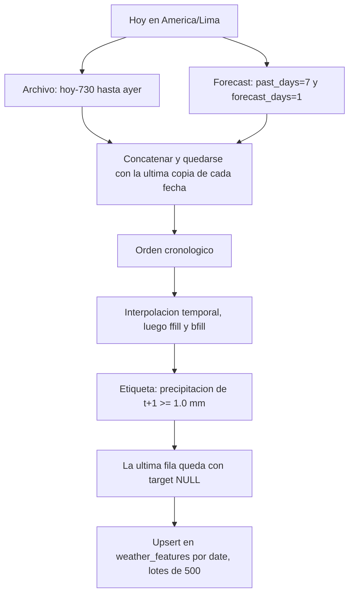
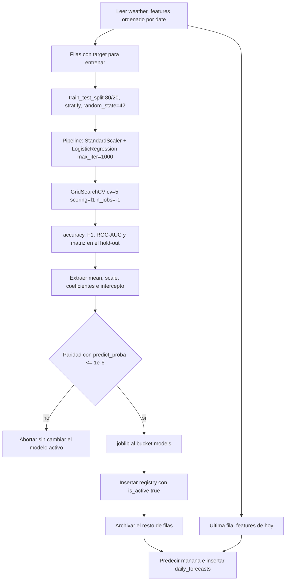
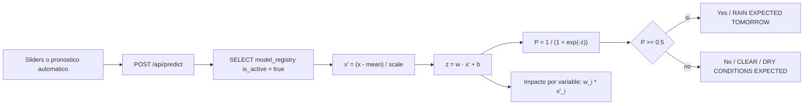
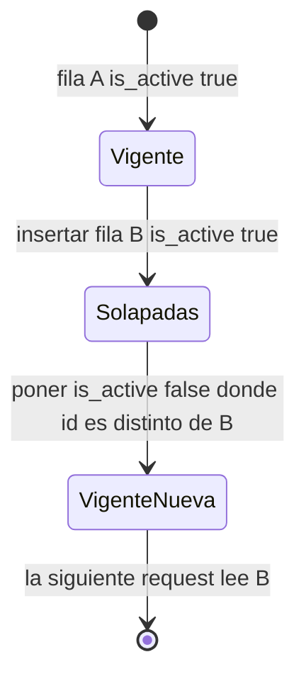

# Arquitectura y pipeline MLOps

Plataforma de clasificación binaria para Puno. La inferencia de producción no carga el archivo `.joblib`: usa los pesos JSON publicados en `model_registry`. El binario queda en el bucket `models` para auditoría y descarga.

## Vista de despliegue

```mermaid
flowchart LR
    subgraph fuentes [Fuentes]
        ARC[archive-api.open-meteo.com]
        FRC[api.open-meteo.com]
    end

    subgraph gha [GitHub Actions]
        CI[ci-cd-pipeline.yml]
        CT[mlops-retrain.yml]
    end

    subgraph supa [Supabase eqzsjrfwrolhlualnbdn]
        FS[(weather_features)]
        REG[(model_registry)]
        DF[(daily_forecasts)]
        BKT[Bucket publico models]
    end

    subgraph edge [Vercel]
        UI[Dashboard Next.js en ingles]
        PRED[/api/predict]
        STAT[/api/status]
    end

    ARC --> CT
    FRC --> CT
    CI --> CT
    CT --> FS
    CT --> REG
    CT --> DF
    CT --> BKT
    UI --> STAT
    UI --> PRED
    STAT --> REG
    STAT --> DF
    STAT --> FS
    PRED --> REG
    BKT -. descarga .joblib .-> UI
```

CI y CT están separados. Un pull request no reentrena ni escribe en Supabase. El cron y el botón manual sí escriben, y solo después de que pytest pasa dentro del mismo job.

## ETL de Open-Meteo hacia el feature store



La fuente forecast se concatena después del archivo. `drop_duplicates(keep='last')` hace que el dato reciente gane en los días solapados. La etiqueta usa el día siguiente ya unido, así que un duplicado no deja la etiqueta apuntando a un valor viejo.

No se rellena la etiqueta. `bfill` solo actúa sobre las siete features. El día en curso no tiene mañana observada.

## Ciclo de entrenamiento con GridSearchCV



La grilla explora 6 valores de `C`, 2 esquemas de `class_weight` y 2 solvers: 24 combinaciones por 5 pliegues. El F1 es la métrica de selección porque la pregunta operativa es detectar el día de lluvia, no solo acertar la clase mayoritaria de la estación seca del altiplano. `class_weight='balanced'` está dentro de la grilla para que la validación cruzada decida si hace falta compensar la proporción de clases. El hold-out no participa en esa elección.

Hiperparámetros guardados en `best_hyperparameters`: los tres parámetros ganadores más `cv_folds`, `scoring`, `best_cv_f1`, `test_size` y `random_state`. `dataset_rows` cuenta los días etiquetados que entraron al split, no la fila de hoy.

## Inferencia matemática en Next.js



La misma función está en `ml_pipeline/inference_math.py` y en `frontend/src/lib/modelEngine.ts`. La sigmoide es estable: para `z >= 0` usa `1 / (1 + exp(-z))`; para `z < 0` usa `exp(z) / (1 + exp(z))`. Así se evita el desbordamiento que rompería la tolerancia de `1e-6`.

El impacto que muestra el simulador es el término del logit, `coeficiente × feature estandarizada`. Esos siete términos más el intercepto suman `z`. Multiplicar el coeficiente por el valor crudo en °C o mm no reconstruye el modelo, porque el `StandardScaler` ya formó parte del `Pipeline` ajustado.

`/api/status` no calcula una predicción nueva. Devuelve el pronóstico ya persistido, el modelo activo, el historial de versiones y los últimos 10 días de `weather_features`. El botón **Refresh Live MLOps State** vuelve a llamar ese endpoint sin recargar el documento.

## Zero-downtime



Entre el insert y el update existen dos filas activas durante un instante. La API ordena por `created_at` descendente y se queda con una. No existe una ventana sin modelo, que sí existiría si primero se apagaran todas las filas y después se insertara la nueva. El resultado persistido es el que pide el esquema: una sola versión activa y las anteriores archivadas.

El proceso de Next.js no participa en el estado. Reiniciar Vercel, hacer un deploy del frontend o pulsar refresh son operaciones independientes. El deploy cambia código; el workflow de MLOps cambia datos. Pueden ocurrir a la vez.
