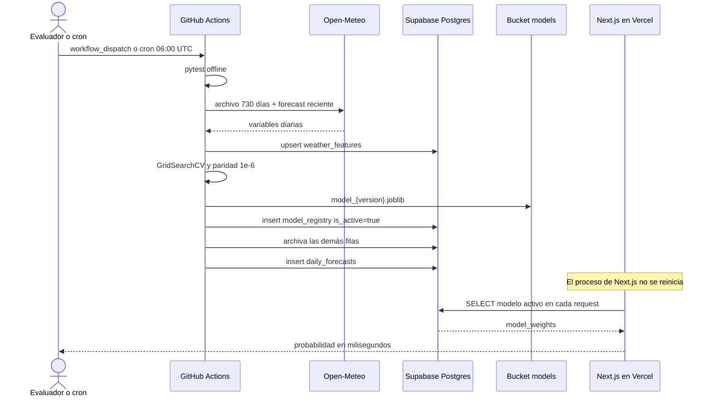

# Informe técnico de TI — RainCast MLOps (Puno)

Sistema de clasificación binaria supervisada para la pregunta **¿lloverá mañana?** en Puno, Perú (`latitud -15.8402`, `longitud -70.0219`, `America/Lima`). La interfaz de usuario está en inglés. Este informe describe el despliegue, la organización del código y el mantenimiento continuo para el equipo de TI.

Umbral de la etiqueta: `target_rain_tomorrow = 1` cuando `precipitation_sum` del día siguiente es mayor o igual a `1.0 mm`; `0` cuando es menor. El día de hoy queda con etiqueta `NULL` porque su mañana todavía no ocurrió.

## 1. Herramientas, plataformas y aplicaciones

| Herramienta | Papel en esta arquitectura | Por qué se usa aquí |
| --- | --- | --- |
| Open-Meteo Archive API (`archive-api.open-meteo.com`) | Historia diaria de 730 días | Fuente meteorológica sin API key, con las siete variables diarias exigidas y zona horaria `America/Lima`. |
| Open-Meteo Forecast API (`api.open-meteo.com`) | Últimos 7 días y el día en curso | El archivo histórico suele ir unos días atrás. El forecast con `past_days=7` cierra esa ventana y aporta la fila de hoy. |
| Supabase PostgreSQL | Feature store (`weather_features`), model registry (`model_registry`) y pronósticos (`daily_forecasts`) | Un solo Postgres sostiene datos, métricas, hiperparámetros y los pesos JSON con los que Next.js calcula la sigmoide. |
| `@supabase/supabase-js` y `supabase` (Python) | Clientes de aplicación y de entrenamiento | El mismo proyecto se consulta desde las rutas servidor de Next.js y desde el job de Python. |
| Supabase Storage, bucket público `models` | Artifact store de binarios `.joblib` | Conserva el estimador de scikit-learn para auditoría y descarga. La inferencia en línea no depende de ese binario. |
| Python 3.11, scikit-learn, pandas, numpy, joblib, requests | Entrenamiento y contrato matemático | `Pipeline(StandardScaler, LogisticRegression)` optimizado con `GridSearchCV` (`scoring='f1'`). |
| pytest | Puerta de calidad | Pruebas offline de columnas, convergencia de la búsqueda y paridad `predict_proba` contra la fórmula desacoplada. |
| GitHub Actions | CI/CD y Continuous Training | Dos workflows separados: validación en cada push/PR y reentrenamiento programado o manual. |
| Next.js (App Router, TypeScript, Tailwind, Lucide) en Vercel | Inferencia serverless y dashboard | `/api/predict` y `/api/status` leen el modelo activo en cada request. No hay un proceso con el modelo clavado en memoria. |

La separación es deliberada. Open-Meteo no almacena el historial del proyecto. Supabase no entrena. GitHub Actions no atiende al usuario. Vercel no guarda el artefacto. Cada pieza se puede sustituir sin mover las demás: otro orquestador puede llamar los mismos módulos `python -m`, y otro frontend puede consumir el mismo JSON de `model_weights`.

El archivo local de arranque menciona un `WEBHOOK_SECRET` pensado para pedirle a Render que recargue un modelo en RAM. Ese mecanismo no forma parte de este despliegue. El hot-swap ocurre en la fila `is_active` de `model_registry`. El secreto queda registrado en el `.env` local para no perder el dato, y no se inyecta en Vercel ni en GitHub.

## 2. Organización del código fuente

```text
.
├── .github/workflows/
│   ├── ci-cd-pipeline.yml          # CI: pytest + build de Next.js
│   └── mlops-retrain.yml           # CT: cron 06:00 UTC y ejecución manual
├── ml_pipeline/
│   ├── config.py                   # Coordenadas, features, grilla y credenciales
│   ├── fetch_data.py               # ETL Open-Meteo → weather_features
│   ├── train_and_evaluate.py       # GridSearchCV, métricas, storage y registry
│   ├── inference_math.py           # Sigmoide desacoplada (contrato con TypeScript)
│   ├── requirements.txt
│   └── tests/test_mlops.py         # Suite offline
├── frontend/
│   ├── src/app/page.tsx            # Dashboard en inglés
│   ├── src/app/api/predict/route.ts
│   ├── src/app/api/status/route.ts
│   ├── src/lib/modelEngine.ts      # Misma fórmula que inference_math.py
│   ├── src/lib/supabase.ts         # Cliente servidor (service role) y cliente anon
│   ├── src/lib/registry.ts         # Lectura y normalización de filas
│   ├── src/types/mlops.ts          # Contratos TypeScript
│   └── src/components/             # Pronóstico, simulador, registry y feature store
├── docs/                           # Informe, arquitectura y guion de exposición
├── pytest.ini
├── .env                            # Local, ignorado por git
└── README.md
```

Responsabilidades que el equipo de mantenimiento no debe mezclar:

- `config.py` es el único lugar de coordenadas, umbral de 1.0 mm, orden de las siete columnas y la grilla de hiperparámetros. El test `test_feature_columns_definition` fija ese orden.
- `fetch_data.py` descarga, une por fecha, se queda con la fuente más reciente cuando hay duplicados, interpola huecos y calcula la etiqueta con `shift(-1)`. Hace upsert en lotes de 500 sobre la clave `date`.
- `train_and_evaluate.py` no vuelve a descargar Open-Meteo. Lee `weather_features`, aparta la última fila para el pronóstico de mañana, ajusta el modelo y publica.
- `inference_math.py` y `frontend/src/lib/modelEngine.ts` deben cambiarse juntos. Si la fórmula diverge, pytest o la aserción previa a la publicación detienen el despliegue del modelo.
- Las rutas de Next.js no importan Python ni el `.joblib`. Solo leen JSON.
- Los workflows no contienen lógica de negocio: instalan dependencias y llaman a los módulos.

El orden contractual de las features es:

1. `temperature_2m_max` (°C)
2. `temperature_2m_min` (°C)
3. `apparent_temperature_max` (°C)
4. `wind_speed_10m_max` (km/h)
5. `shortwave_radiation_sum` (MJ/m²)
6. `et0_fao_evapotranspiration` (mm)
7. `precipitation_sum` (mm)

## 3. Consideraciones de despliegue inicial

Las tres tablas y el bucket `models` ya existen en el proyecto `eqzsjrfwrolhlualnbdn`, con RLS desactivado. El script siguiente es el de referencia para reconstruir el esquema. Usa `IF NOT EXISTS` y no borra datos.

```sql
create table if not exists public.weather_features (
  date date primary key,
  temperature_2m_max double precision,
  temperature_2m_min double precision,
  apparent_temperature_max double precision,
  wind_speed_10m_max double precision,
  shortwave_radiation_sum double precision,
  et0_fao_evapotranspiration double precision,
  precipitation_sum double precision,
  target_rain_tomorrow integer
);

create table if not exists public.model_registry (
  id serial primary key,
  version varchar(50) not null,
  created_at timestamptz not null default now(),
  algorithm varchar(50) not null,
  best_hyperparameters jsonb not null,
  accuracy double precision,
  f1_score double precision,
  roc_auc double precision,
  confusion_matrix jsonb,
  dataset_rows integer,
  model_weights jsonb not null,
  storage_path varchar(255),
  is_active boolean not null default false
);

create table if not exists public.daily_forecasts (
  id serial primary key,
  forecast_for_date date not null,
  created_at timestamptz not null default now(),
  model_version varchar(50) not null,
  will_rain boolean not null,
  rain_probability double precision not null,
  input_features jsonb not null
);

create index if not exists model_registry_active_created_idx
  on public.model_registry (is_active, created_at desc);

create index if not exists daily_forecasts_created_idx
  on public.daily_forecasts (created_at desc);

insert into storage.buckets (id, name, public)
values ('models', 'models', true)
on conflict (id) do update set public = true;
```

Con RLS desactivado, la clave anónima puede leer y escribir. Por eso el navegador no recibe la `service_role` y las rutas de inferencia viven en el servidor. Cuando el equipo active RLS, debe conservar políticas de lectura pública del bucket `models` y mover toda escritura al service role que ya usan Python y las API routes. Hasta ese cambio, no hay que pegar la service role en una variable `NEXT_PUBLIC_`.

### Puesta en marcha

1. Confirmar en Supabase que existen `weather_features`, `model_registry`, `daily_forecasts` y el bucket público `models`.
2. Copiar la URL y las dos claves desde `credenciales y datos importantes pre iniciar.txt` hacia el `.env` de la raíz y hacia `frontend/.env.local`. En este entorno de desarrollo ese paso ya está hecho.
3. Crear los tres GitHub Secrets (`SUPABASE_URL`, `SUPABASE_SERVICE_ROLE_KEY` y, de forma opcional, `SUPABASE_ANON_KEY`).
4. Instalar dependencias y ejecutar la primera publicación:

```powershell
python -m pip install -r ml_pipeline/requirements.txt
python -m pytest ml_pipeline/tests/ -v
python -m ml_pipeline.fetch_data
python -m ml_pipeline.train_and_evaluate
```

5. Arrancar el frontend con `npm install` y `npm run dev` dentro de `frontend`, o desplegar ese directorio en Vercel con las cuatro variables de entorno descritas en el `README.md`.
6. Abrir la aplicación, pulsar **Refresh Live MLOps State** y comprobar versión, métricas, enlace al `.joblib` y la fila de `daily_forecasts`.

El build de CI compila Next.js aunque el pull request no tenga secrets: el workflow sustituye URL y claves ficticias. Esas claves ficticias solo sirven para `npm run build`. No sirven para entrenar.

Cada fila de `model_registry.model_weights` sale del estimador ya ajustado y contiene exactamente estas claves: `feature_names` (las siete columnas, en el orden de arriba), `scaler_mean` (7 medias del `StandardScaler`), `scaler_scale` (7 desviaciones; un cero se trata como 1 al dividir), `coefficients` (7 coeficientes de la clase positiva), `intercept` (un float) y `threshold` (`0.5`). `confusion_matrix` se guarda como `[[TN, FP], [FN, TP]]`. La versión sigue el patrón `v1.0.YYYYMMDD_HHMMSS` en hora de Lima. El algoritmo guardado es `LogisticRegression (GridSearchCV)`.

## 4. Flujos de mantenimiento e integración continua

### Integración continua (cada push o PR a `main`)

El workflow `DevOps CI - Automated Tests & Build Validation` lanza dos jobs en paralelo:

1. `pytest-ml-validation`: Python 3.11, instalación de `ml_pipeline/requirements.txt` y `pytest ml_pipeline/tests/ -v`.
2. `nextjs-build-validation`: Node 20, `npm install` y `npm run build` en `frontend/`.

Esas pruebas no llaman a Open-Meteo ni a Supabase. Un PR con una grilla rota, una columna renombrada o una sigmoide distinta al `predict_proba` de scikit-learn queda rojo antes de tocar producción.

### Entrenamiento continuo

El workflow `MLOps Continuous Training & Deployment Pipeline` se dispara todos los días a las 06:00 UTC y también con **Run workflow**. El orden es fijo:

1. Checkout e instalación de Python 3.11.
2. `pytest` como compuerta. Si falla, no hay ingesta ni publicación.
3. `python -m ml_pipeline.fetch_data`.
4. `python -m ml_pipeline.train_and_evaluate`.

El entrenamiento hace lo siguiente:

- Separa filas con etiqueta de la última fila (hoy).
- Parte 80/20 con `stratify` y `random_state=42`.
- Ajusta `GridSearchCV` con validación cruzada de 5 pliegues, `scoring='f1'` y `n_jobs=-1`.
- Grilla: `C` en `[0.01, 0.1, 0.5, 1.0, 5.0, 10.0]`, `class_weight` en `[None, 'balanced']`, `solver` en `['lbfgs', 'liblinear']`.
- Mide accuracy, F1, ROC-AUC y matriz de confusión en el hold-out.
- Exige paridad matemática absoluta `<= 1e-6` entre scikit-learn y `inference_math.py`.
- Sube `model_{version}.joblib` y `model_latest.joblib` al bucket `models` con upsert.
- Inserta la fila nueva con `is_active = true` y después marca `is_active = false` en todas las demás. El estado final cumple la regla de un solo modelo vigente, y durante el cambio siempre hay al menos una fila activa.
- Inserta el pronóstico de mañana (`hoy + 1 día`) en `daily_forecasts` usando las features de hoy.



### Por qué no hay corte de servicio

La inferencia es stateless. Vercel no conserva el estimador entre requests. `/api/predict` ejecuta esta secuencia en cada llamada:

1. Lee la fila `is_active = true` más reciente.
2. Estandariza con `scaler_mean` y `scaler_scale`.
3. Calcula `z = w · x_scaled + b` y `P = 1 / (1 + e^{-z})`.
4. Responde clase, probabilidad, versión, tiempo de la matemática e impacto `w_i * x_i_scaled` de cada variable.

Publicar un modelo nuevo no despliega un servidor nuevo ni invalida un caché de proceso. La siguiente request ya ve la fila nueva. La request que estaba en vuelo termina con los pesos que leyó al empezar. El enlace **Download .joblib Model Artifact** apunta al objeto versionado, que no se reescribe: `model_latest.joblib` sí se actualiza, el archivo de la versión publicada no.

Si la inserción del registry falla, la fila anterior sigue activa. Si la paridad matemática falla, la excepción ocurre antes de subir el registro activo.

### Protocolo de verificación para TI

1. Ejecutar `pytest ml_pipeline/tests/ -v` y exigir tres pruebas verdes: definición de features, GridSearchCV y paridad.
2. Ejecutar ingesta y entrenamiento. Anotar la versión `v1.0.*` que imprime el proceso.
3. En Supabase, comprobar una sola fila con `is_active = true`, el JSON de `model_weights` con siete coeficientes y un objeto nuevo en el bucket `models`.
4. Abrir la aplicación en inglés. **Refresh Live MLOps State** debe mostrar esa versión, las cuatro métricas, la matriz 2x2, el historial Active/Archived y los últimos 10 días del feature store.
5. En Live Inference, pulsar **Heavy Storm Front** y **Typical Dry Winter Day**. La respuesta debe incluir `model_version` igual a la fila activa e `inference_ms`.
6. Lanzar otra vez el workflow manual. La versión del banner cambia y la anterior pasa a Archived. La pestaña del navegador no se recarga sola: el botón de refresh es la prueba de que el proceso siguió atendiendo.

### Primera publicación verificada (20 de octubre de 2026)

La ingesta y el entrenamiento se ejecutaron contra el proyecto `eqzsjrfwrolhlualnbdn`. El registry queda como fuente vigente: un reentrenamiento posterior sustituye estas cifras.

| Campo | Valor observado |
| --- | --- |
| Versión | `v1.0.20261020_145359` |
| Días etiquetados | 730, más la fila del 2026-10-20 sin etiqueta |
| Hold-out | accuracy 0.788, F1 0.789, ROC-AUC 0.892 |
| Mejor F1 de validación cruzada | 0.827 |
| Hiperparámetros | `C=0.01`, `class_weight=null`, `solver=lbfgs` |
| Matriz `[[TN, FP], [FN, TP]]` | `[[57, 15], [16, 58]]` |
| Pronóstico | 2026-10-21, lluvia, probabilidad 0.651 |
| Artefacto | `model_v1.0.20261020_145359.joblib` en el bucket `models` |

`/api/status` respondió `Zero-Downtime Active`. Un POST de tormenta devolvió lluvia con probabilidad 0.858 en menos de 1 ms y siete impactos. Un día seco de invierno devolvió clase negativa con probabilidad 0.143. El `.joblib` público se volvió a cargar con `joblib.load` y produjo una probabilidad finita.

El cron de las 06:00 UTC corresponde a la 01:00 en Lima. A esa hora, la precipitación del día civil recién empieza, así que la fila de “hoy” mezcla observación reciente y pronóstico del propio día. Es el comportamiento pedido por la ventana `past_days=7` y `forecast_days=1`. Si operación necesita el día ya cerrado, el cambio se hace solo en el cron del workflow; el código de entrenamiento no depende de la hora.
